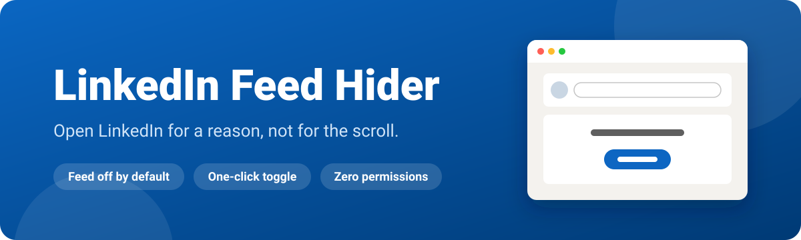
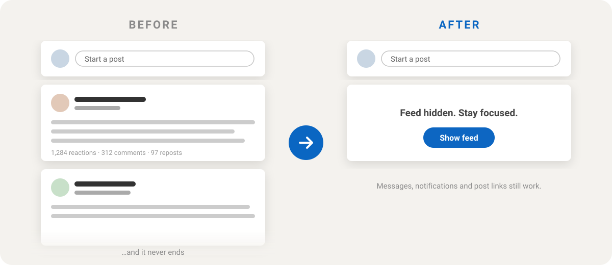

<p align="center">
  
</p>

<p align="center">
  
  
  
  
  
</p>

<p align="center">
  <b>A tiny Chrome extension that hides the LinkedIn feed by default.</b><br>
  Post, message, check notifications, open links. Skip the endless scroll.<br>
  Want the feed after all? It's one click away.
</p>

---

## ✨ Before & after

<p align="center">
  
</p>

## 🎯 Features

| | |
|---|---|
| 🙈 **Feed off by default** | Every visit to `linkedin.com/feed` starts with the feed hidden. |
| 👆 **One-click toggle** | A **Show feed** button sits right where the feed would be. **Hide feed again** puts it away. |
| ✍️ **Posting still works** | The "Start a post" box stays visible. |
| 🔗 **Post links still work** | Posts you open from notifications, messages or anywhere else show up normally, without the feed underneath. |
| 🧭 **Survives LinkedIn's SPA** | Navigating around LinkedIn without a page reload is handled too. |
| 🛟 **Fails safe** | If LinkedIn changes its markup, the button floats in the corner instead of disappearing. |
| 🔒 **Private by design** | No permissions, no storage, no network requests, no analytics. |

## 🚀 Install

> Not on the Chrome Web Store (yet). Installing takes about 30 seconds.

1. **Download** this repo: `git clone https://github.com/jenstools/linkedin-feed-hider.git`, or use **Code → Download ZIP** and unzip it.
2. Open **`chrome://extensions`**.
3. Turn on **Developer mode** (toggle, top right).
4. Click **Load unpacked** and select the `linkedin-feed-hider` folder.
5. Open or reload **[linkedin.com/feed](https://www.linkedin.com/feed/)**. 🧘

Works in Chrome and in other Chromium browsers (Edge, Brave, Arc, Opera, Vivaldi).

**Updating:** `git pull` (or download the ZIP again), then click ↻ on the extension in `chrome://extensions`.

## 🧠 How it behaves

| You open… | What happens |
|---|---|
| `linkedin.com/feed` | Feed hidden, **Show feed** button shown |
| A post (`/feed/update/…`, `/posts/…`) | Untouched, the post shows normally |
| A notification link (`/feed/?highlightedUpdateUrn=…`) | Redirected to that post's own page, so you get the post without the feed |
| Anything else (profiles, messages, jobs, search) | Untouched |

Clicking **Show feed** only lasts for the current visit. The next time you open the feed, it's hidden again. That's on purpose.

## 🛠 How it works

```
linkedin-feed-hider/
├── manifest.json   # MV3 manifest: one content script on linkedin.com, no permissions
├── content.css     # Hides the feed while <html> has the .lfh-hidden class
├── content.js      # Toggles that class, places the button, handles redirects + SPA navigation
└── assets/         # README graphics
```

- **CSS does the hiding.** `content.css` is injected at `document_start` and hides every child of LinkedIn's feed list (`[data-testid="mainFeed"]`) except the first one, which is the "Start a post" box. The feed never flashes on screen.
- **JS does the rest.** `content.js` adds `.lfh-hidden` to `<html>` on the feed page only, inserts the toggle button, and uses a `MutationObserver` to keep up with LinkedIn's client-side navigation and lazy rendering.
- **Fallbacks.** Selectors for LinkedIn's older markup are still included. If neither layout is found, the button floats bottom-right so you're never stuck.

## 🩺 Troubleshooting

**The feed is still visible.**
Reload the LinkedIn tab after installing or updating the extension. If that doesn't help, LinkedIn has probably changed its markup again. [Open an issue](https://github.com/jenstools/linkedin-feed-hider/issues) and I'll update the selectors.

**The button is floating in the bottom-right corner.**
That's the fallback: the extension couldn't find the feed container. Same fix as above. Please open an issue.

**I want the feed back permanently.**
Turn the extension off in `chrome://extensions`. No hard feelings.

## 📄 License

[MIT](LICENSE). Do whatever you want with it.
